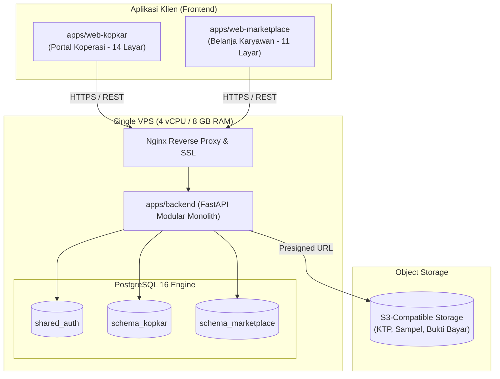

# KopKar SAI Digital Ecosystem

[](https://fastapi.tiangolo.com)
[](https://react.dev)
[](https://www.typescriptlang.org)
[](https://tailwindcss.com)
[](https://www.postgresql.org)
[](https://pnpm.io)

Ekosistem digital resmi **Koperasi Karyawan PT SAI (KOPKARSAI)** yang dikembangkan di bawah tata kelola **"One Contract — Two Applications"**: satu backend bersama yang melayani portal keanggotaan koperasi dan platform belanja internal marketplace.

---

## 1. Arsitektur "One Contract — Two Applications"

Sistem mengadopsi model klasifikasi 4-scope wajib guna menjaga pemisahan domain yang bersih dan mencegah polusi dependensi:

```text
CONTRACT (Induk Legal, Tata Kelola & Komersial)
├── SHARED       ──► Infrastruktur bersama: Single VPS, Auth Terpadu (NIK), S3 Storage, In-App Notification
├── KOPKAR       ──► Modul Keanggotaan, Dual-Approval, Simpan Pinjam, Hub UMKM, Uji Kelayakan Sampel
└── MARKETPLACE  ──► Modul Katalog Belanja Same-Day, Pre-Order Katering H-1, Kasir Rak Toko, Antrean GA
```



---

## 2. Struktur Repositori Monorepo

```text
kopkarsai-ecosystem/
├── .agents/                               # Konfigurasi AI Agent (Google Antigravity)
│   ├── rules/                             # 8 Aturan arsitektur & coding invariants (01 - 08)
│   └── skills/                            # 6 Runbook operasional & domain scafolders
├── apps/
│   ├── backend/                           # FastAPI modular monolith service
│   ├── web-kopkar/                        # React + TypeScript frontend Koperasi (Mobile-First)
│   └── web-marketplace/                   # React + TypeScript frontend Marketplace
├── docs/
│   ├── COLOR_PALETTE.md                   # Dokumentasi induk sistem desain terpadu Japanese Style (Kyoto Heritage)
│   └── project-knowledge/                 # [Git Submodule] Single Source of Truth:
│       ├── data/                          # Requirements (KK-REQ, MP-REQ), Decisions, Business Rules
│       ├── docs/                          # Technical specs, architecture decisions
│       └── latex/                         # Dokumen kontrak legal terkontrol (DOC-001 - DOC-003)
├── .gitignore                             # Global ignore untuk node_modules, dist, venv, build artifacts
├── .gitmodules                            # Pendaftaran submodule docs/project-knowledge
├── AGENTS.md                              # Workspace core invariants & tata kelola domain
└── README.md                              # Panduan utama ekosistem
```

---

## 3. Komponen Aplikasi

### A. [Web KOPKAR (`apps/web-kopkar`)](./apps/web-kopkar/README.md)
* **Katalog Layar:** 14 Layar resmi (`KK-SCR-001` s/d `KK-SCR-014`).
* **Fitur Utama:**
  * Dashboard Beranda: Hero financial card berlatar pastel sage (`#DFF3E7`), ornamen geometris 3D koin/silinder, dan bento layanan unggulan.
  * Modul Finansial: Simulasi pinjaman interaktif flat & menurun, tabel jadwal amortisasi bulanan, ekspor Excel (.xlsx), dan proyeksi simpanan + SHU.
  * Hub UMKM Supplier: Konfirmasi pesanan katering H-1, pelacakan stepper kurasi sampel makanan, rekomendasi analitik suplai harian, dan pendaftaran produk mitra baru.
  * Akun E-Member: Kartu keanggotaan digital resmi dengan chip RFID dan verifikasi QR code.

### B. [Web MARKETPLACE (`apps/web-marketplace`)](./apps/web-marketplace/README.md)
* **Katalog Layar:** 11 Layar resmi (`MP-SCR-001` s/d `MP-SCR-011`).
* **Fitur Utama:**
  * Belanja Toko Fisik Same-Day dengan alur verifikasi checklist etalase rak oleh kasir (`MP-DEC-001`).
  * Pre-Order Katering H-1 dengan alur konfirmasi kesanggupan supplier dan notifikasi WhatsApp.
  * Antrean prioritas pemrosesan pesanan kantor untuk divisi General Affairs (`MP-DEC-002`).

### C. [Backend Service (`apps/backend`)](./apps/backend/README.md)
* **Teknologi:** FastAPI, SQLAlchemy 2.0 Async, Pydantic v2, PostgreSQL 16.
* **Isolasi Skema:**
  * `shared_auth`: Autentikasi NIK terpadu, session JWT, audit trail, user role management.
  * `schema_kopkar`: Simpan pinjam, keanggotaan, pengajuan supplier, uji sampel organoleptik.
  * `schema_marketplace`: Katalog barang toko fisik, katering basah, pesanan, verifikasi kasir.

---

## 4. Invarian Sistem & Batasan Komputasi VPS

1. **Alokasi Sumber Daya Single VPS (4 vCPU / 8 GB RAM):**
   * OS & System: ~1.0 GB RAM
   * Nginx & SSL: ~0.5 GB RAM
   * PostgreSQL Engine (`shared_auth`, `schema_kopkar`, `schema_marketplace`): ~2.5 - 3.0 GB RAM
   * Backend FastAPI Process & Worker: ~1.5 GB RAM
   * Background Worker & Cache: ~0.5 GB RAM
   * Swap Disk NVMe: 4.0 GB buffer untuk mencegah *Out-of-Memory (OOM)* kill.
2. **Penyimpanan Berkas S3 Eksternal (`SH-DEC-003`):**
   * Berkas foto KTP, bukti transfer, dan gambar produk **wajib diunggah ke Object Storage S3-compatible** (maksimal 3.0 MB per berkas).
   * Dilarang menyimpan file biner mentah pada SSD lokal VPS atau PostgreSQL BYTEA.
3. **Integritas Finansial (*Non-Destructive Invariant*):**
   * Dilarang keras mengeksekusi raw `DELETE` pada data transaksi, pesanan, dan catatan audit. Gunakan status atau soft-delete.
   * Seluruh nilai moneter wajib menggunakan tipe data `Numeric(15, 2)` / `Decimal`. Dilarang menggunakan `float`.
4. **Verifikasi Registrasi Berjenjang Dual-Approval (`KK-DEC-001`):**
   * Karyawan mendaftar mandiri → Verifikasi Tahap 1 oleh Admin Toko → Persetujuan Final oleh Kepala Koperasi → Akun aktif berbelanja.

---

## 5. Panduan Memulai Cepat (Quick Start)

### 1. Kloning Repositori Bersama Submodule
```bash
git clone --recurse-submodules git@github.com:kopkar-xyz/kopkarsai-ecosystem.git
cd kopkarsai-ecosystem
```

Jika repositori sudah terlanjur di-clone tanpa submodule:
```bash
git submodule update --init --recursive
```

### 2. Menjalankan Frontend Koperasi (`apps/web-kopkar`)
```bash
cd apps/web-kopkar
pnpm install
pnpm dev --port 5173
```
Aplikasi dapat dibuka di browser: `http://localhost:5173/`.

### 3. Menjalankan Frontend Marketplace (`apps/web-marketplace`)
```bash
cd apps/web-marketplace
pnpm install
pnpm dev --port 5175
```
Aplikasi dapat dibuka di browser: `http://localhost:5175/`.

### 4. Menjalankan Backend API (`apps/backend`)
```bash
cd apps/backend
python3 -m venv .venv
source .venv/bin/activate
pip install -r requirements.txt
uvicorn app.main:app --reload --port 8000
```
Dokumentasi OpenAPI Swagger: `http://localhost:8000/docs`.

---

## 6. Antigravity AI Agent Rules & Skills

Repositori ini telah dikonfigurasi dengan instruksi agen AI terpadu pada direktori [`.agents/`](./.agents/):
* **Rules (`.agents/rules/`):**
  * `01-ecosystem-architecture.md`: Batasan monorepo, VPS compute budget, dan pemisahan scope.
  * `02-business-knowledge-sync.md`: Prosedur sinkronisasi kode dengan spesifikasi YAML di `docs/project-knowledge`.
  * `03-security-rbac-clean-code.md`: Standar RBAC 6-role, validasi Pydantic v2, dan proteksi media S3.
  * `04-backend-fastapi-architecture.md`: Struktur modular monolith FastAPI berlapis bersih.
  * `05-database-and-migrations.md`: Isolasi PostgreSQL multi-schema dan presisi finansial `Numeric(15, 2)`.
  * `06-frontend-react-architecture.md`: Modul fitur React, custom hooks, dan paginasi budget 200 baris.
  * `07-ui-design-system.md`: Desain sistem *Soft Emerald × Golden Bento*.
  * `08-qa-e2e-testing.md`: Pengujian Playwright E2E pada skenario bisnis kritis.
* **Skills (`.agents/skills/`):**
  * `backend-domain-scaffold`, `frontend-feature-scaffold`, `db-migration-sync`, `project-knowledge-sync`, `ecosystem-monorepo-ops`, `playwright-e2e`.

---

## 7. Lisensi & Hak Cipta
Hak Cipta © 2026 **Koperasi Karyawan PT SAI (KOPKARSAI)**. Seluruh hak cipta dilindungi undang-undang.
