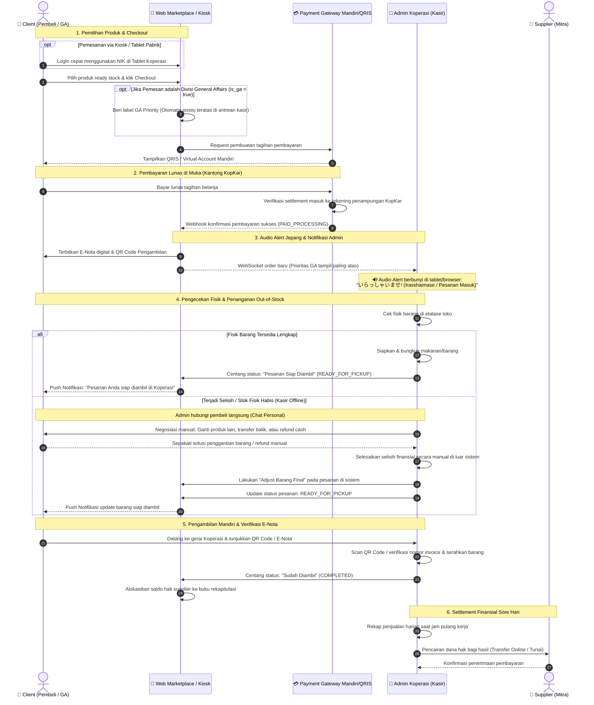
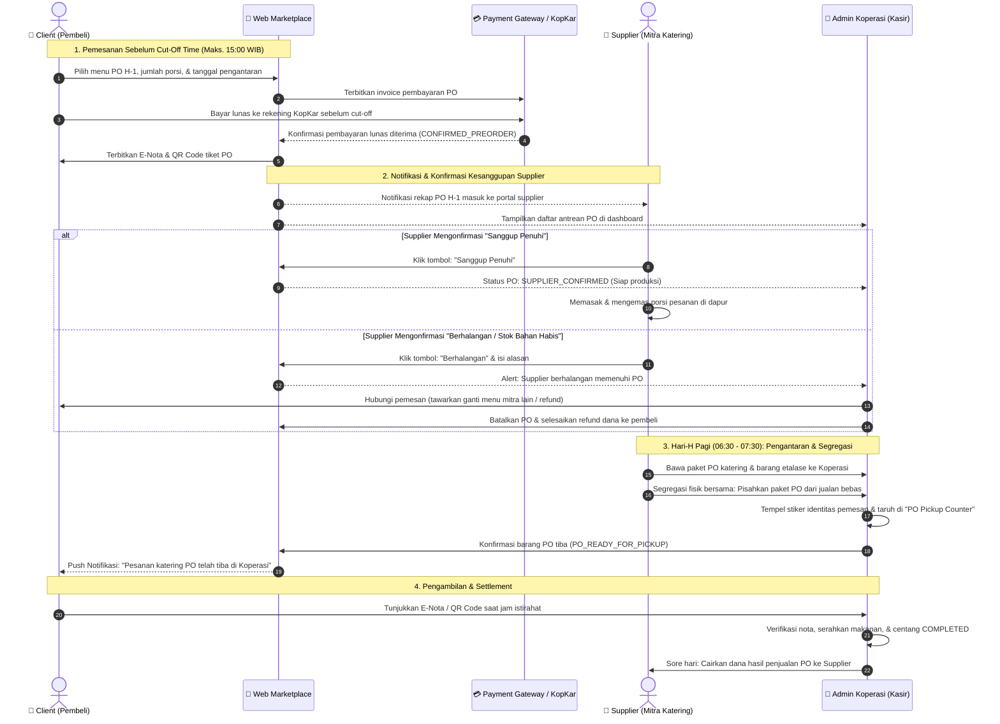
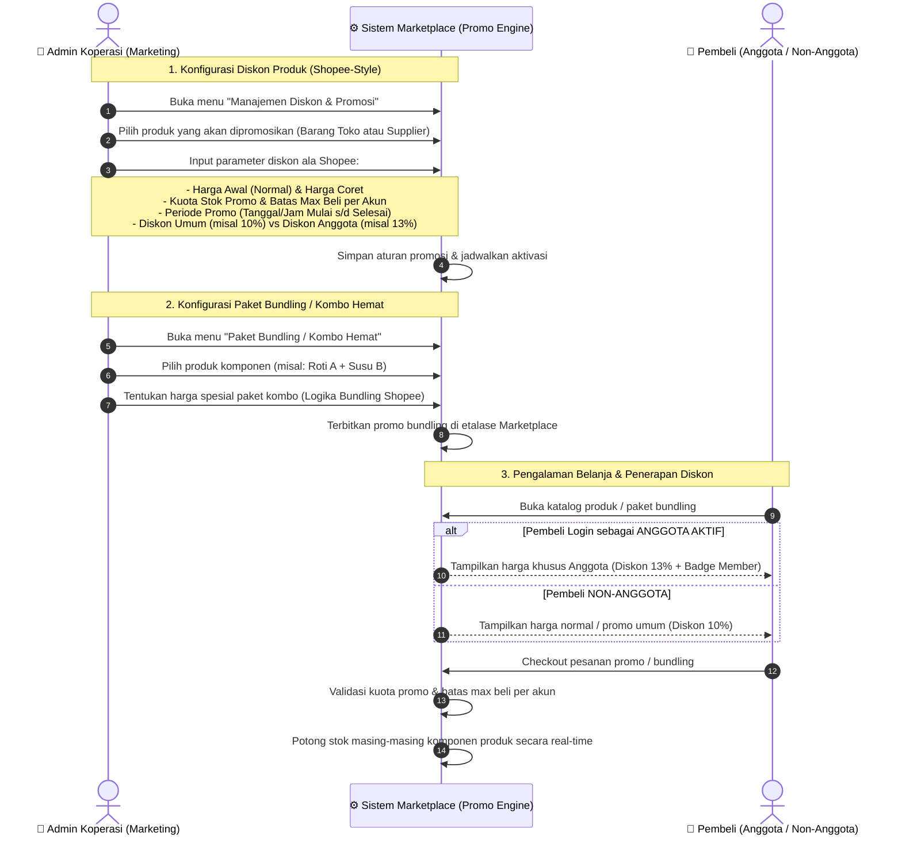
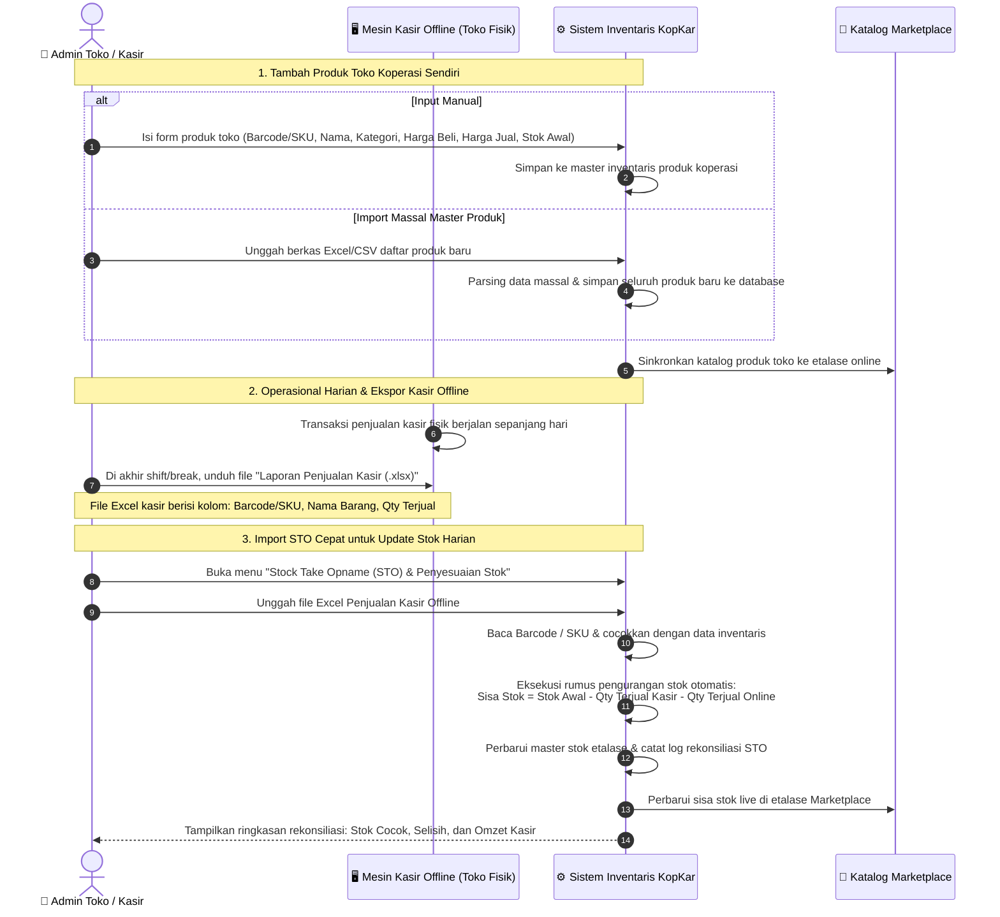
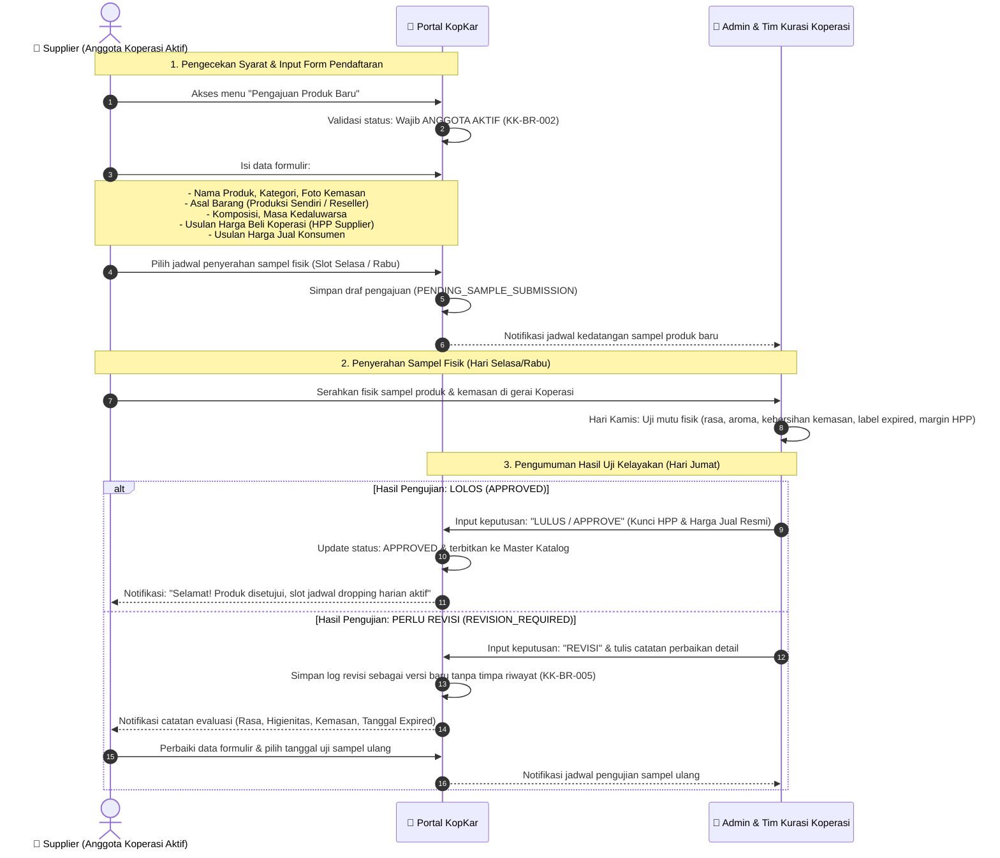
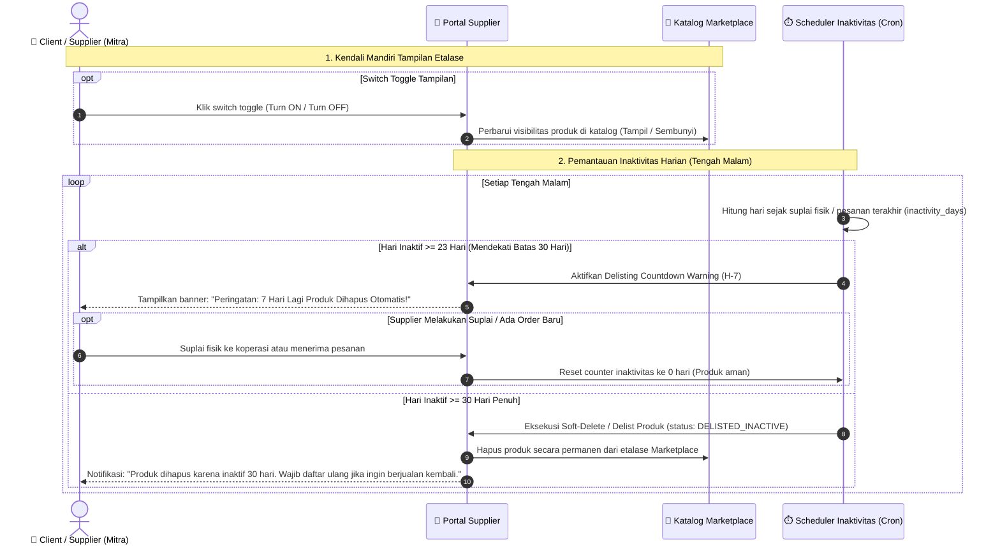
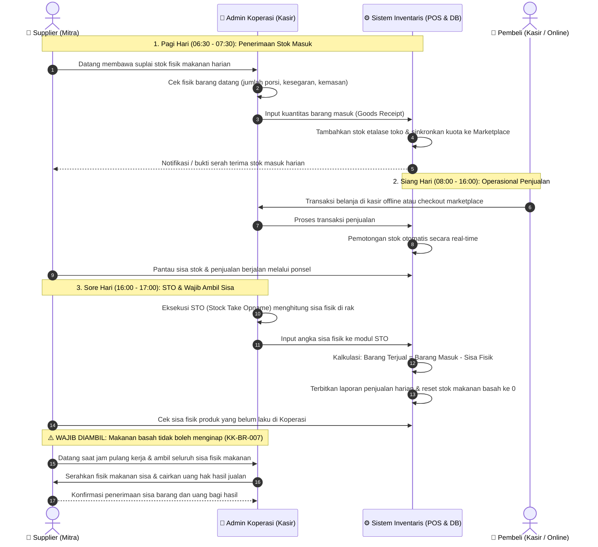
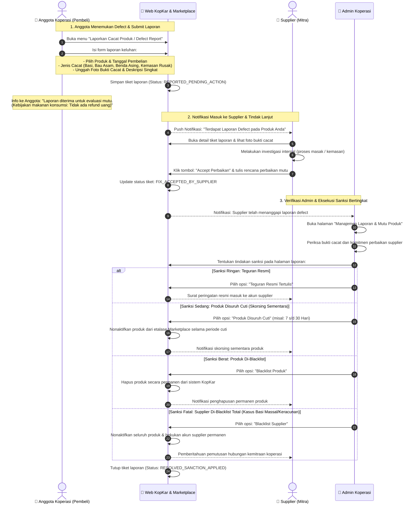
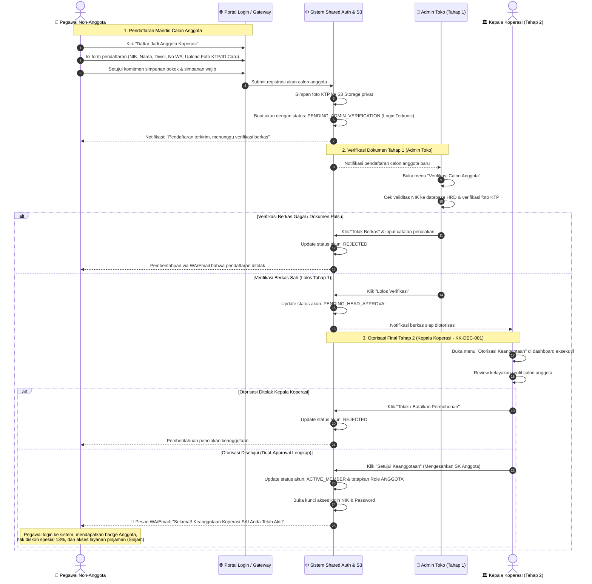
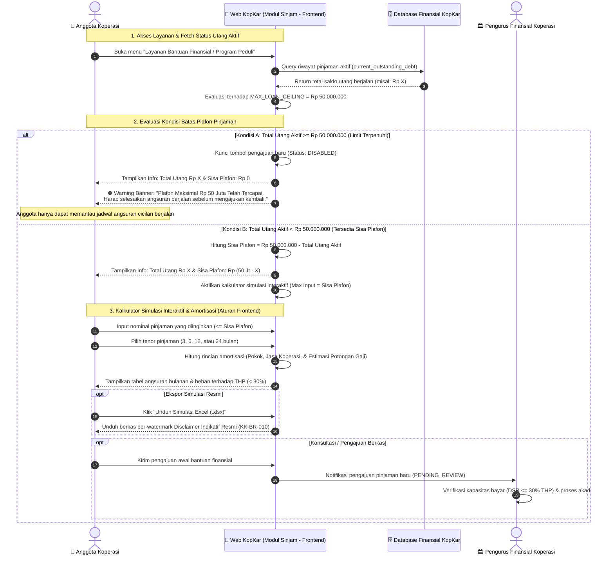

# Sequence Diagram Ekosistem KopKar SAI & Marketplace
*Dokumen Tunggal Alur Proses Bisnis Terpadu: Client, Supplier, Admin Koperasi, dan Kepala Koperasi*

> [!TIP]
> Dokumen ini tersedia dalam versi modular terpisah per topik:
> - 🛒 **Modul 1**: [01-pembelian-marketplace.md](file:///home/mashupsoat/Project/kopkar_xyz/kopkarsai-ecosystem/docs/swimlane-flows/01-pembelian-marketplace.md)
> - 🍱 **Modul 2**: [02-manajemen-produk.md](file:///home/mashupsoat/Project/kopkar_xyz/kopkarsai-ecosystem/docs/swimlane-flows/02-manajemen-produk.md)
> - 👥 **Modul 3**: [03-manajemen-user-keanggotaan.md](file:///home/mashupsoat/Project/kopkar_xyz/kopkarsai-ecosystem/docs/swimlane-flows/03-manajemen-user-keanggotaan.md)
> - 💰 **Modul 4**: [04-simulasi-simpan-pinjam.md](file:///home/mashupsoat/Project/kopkar_xyz/kopkarsai-ecosystem/docs/swimlane-flows/04-simulasi-simpan-pinjam.md)
> - 📑 **Folder Indeks**: [docs/swimlane-flows/README.md](file:///home/mashupsoat/Project/kopkar_xyz/kopkarsai-ecosystem/docs/swimlane-flows/README.md)

---

## 1. Ringkasan Arsitektur & Partisipan (Sequence Lifelines)

Sistem operasional digital KopKar SAI mengintegrasikan tata kelola Koperasi Karyawan (`apps/web-kopkar`) dan Belanja Karyawan (`apps/web-marketplace`) di bawah prinsip **"One Contract — Two Applications"**.

| Partisipan / Lifeline | Simbol & Peran Utama | Lingkup Tanggung Jawab |
| :--- | :--- | :--- |
| **Client / Pembeli** | 👤 `Client` (Karyawan PT SAI) | Memilih produk, melakukan pembayaran di muka, mengambil pesanan dengan nota/QR, melaporkan defect produk, simulasi pinjaman. |
| **Supplier / Mitra UMKM** | 🍱 `Supplier` (Mitra Koperasi) | Mendaftarkan produk, mengirim sampel uji baku, konfirmasi kesanggupan PO H-1, dropping stok harian, segregasi barang PO, merespons defect report, mengambil sisa fisik retur sore hari. |
| **Admin Koperasi / Kasir** | 🏪 `Admin Koperasi` (Pengurus Toko) | Verifikasi fisik & terima stok pagi, penyiapan pesanan offline, handle penyesuaian stok habis manual, serah terima & scan QR nota, Stock Take Opname (STO), import Excel penjualan kasir, verifikasi calon anggota, penetapan sanksi defect. |
| **Kepala Koperasi** | 🏛️ `Kepala Koperasi` (Executive Head) | Approval final berjenjang (Dual-Approval) registrasi keanggotaan (`KK-DEC-001`), otorisasi kebijakan finansial. |
| **Sistem Ekosistem** | ⚙️ `Sistem KopKar & Marketplace` | Validasi payment gateway, audio alert Jepang (*"いらっしゃいませ - Irasshaimase"*), prioritas GA, diskon & bundling Shopee-style, kalkulator limit Rp 50 juta, delisting timer 30 hari. |

---

## 2. Alur 1: Pembelian Marketplace, Promosi & Manajemen Toko

### 2.1 Same-Day Order & Penyesuaian Manual saat Stok Habis
> **Karakteristik**: Pesanan langsung dibayar lunas di muka ke rekening penampungan KopKar (*"kantong kopkar"*). Pembayaran memicu notifikasi visual dan audio alert berbahasa Jepang (*"いらっしゃいませ - Irasshaimase / Ada pesanan baru"*) di tablet/browser Admin Toko. Jika barang fisik habis, admin menghubungi pembeli langsung, selisih diselesaikan manual di luar sistem (cash/transfer/tukar barang), dan admin melakukan *adjust order* final di sistem.

---

### 2.2 Pre-Order (PO H-1) dengan Konfirmasi Kesanggupan Supplier
> **Karakteristik**: Diberlakukan cut-off time (15:00 WIB). Sistem meneruskan rekap PO ke Supplier yang memiliki tombol interaktif untuk mengonfirmasi kesanggupan (*Sanggup Penuhi* vs *Berhalangan*).

---

### 2.3 Manajemen Promosi & Paket Bundling ala Shopee
> **Karakteristik**: Diskon ganda (Normal vs Anggota) dan logika Bundling Shopee (Kombo Hemat) yang diatur penuh oleh Admin Koperasi.

---

### 2.4 Manajemen Produk Koperasi & Import STO Kasir via Excel
> **Karakteristik**: Penambahan master produk toko (manual/import) serta integrasi cepat STO menggunakan file Excel dari mesin kasir offline toko fisik berbasis Barcode/SKU untuk memotong kuantitas terjual.

---

## 3. Alur 2: Manajemen Produk Mitra, STO & Defect Report

### 3.1 Pendaftaran Produk Baru & Uji Kelayakan Sampel Baku
> **Karakteristik**: Penyerahan sampel fisik terikat jadwal baku (Selasa/Rabu, uji Kamis, hasil Jumat) dengan syarat wajib **Anggota Koperasi Aktif** (`KK-BR-002`).

---

### 3.2 Kendali Mandiri Supplier & Kebijakan Delisting 30 Hari

---

### 3.3 Operasional Harian Koperasi & Stock Take Opname (STO)
> **Kewajiban Pengambilan Sisa (`KK-BR-007`)**: Makanan basah tidak boleh menginap di koperasi. **Supplier WAJIB mengambil seluruh sisa fisik saat pulang kerja**.

---

### 3.4 Fitur Pelaporan Cacat Produk (Defect Report) & Sanksi Bertingkat
> **Kebijakan Defect Makanan**: Makanan konsumsi **tidak ada pengembalian uang (no refund)**. Laporan menjadi dasar penegakan mutu & sanksi bertingkat oleh Admin.

---

## 4. Alur 3: Manajemen User & Keanggotaan (Dual-Approval)

### 4.1 Registrasi Pegawai Non-Anggota Menjadi Anggota Koperasi
> **Karakteristik**: Berkas identitas NIK dan foto KTP wajib diverifikasi berjenjang oleh Admin Toko (Tahap 1) dan Kepala Koperasi (Tahap 2) sebelum akun diaktifkan (`KK-DEC-001`).

---

## 5. Alur 4: Simulasi Simpan Pinjam (Sinjam / Bantuan Karyawan)

### 5.1 Validasi Limit Plafon Akumulasi Rp 50 Juta & Kalkulator Simulasi
> **Karakteristik**: Anggota dapat melihat total tagihan berjalan. Jika utang $\ge$ Rp 50 Juta, tombol pengajuan diblokir. Jika utang $<$ Rp 50 Juta, kalkulator simulasi terbuka untuk nominal sisa plafon. Komponen interaktif slider diatur oleh Frontend Developer.

---

## 6. Matriks Status Transisi & Business Rule Invariants

Seluruh alur proses bisnis di atas terikat secara ketat pada aturan kanonikal ekosistem KopKar SAI:

| Modul / Domain | Kode Aturan | Ketentuan Mutlak Sistem |
| :--- | :--- | :--- |
| **Keanggotaan** | `KK-BR-001` / `KK-DEC-001` | **Dual-Approval Berjenjang**: Pendaftaran anggota wajib diverifikasi awal oleh Admin Toko lalu disetujui final oleh Kepala Koperasi sebelum akun dapat login. |
| **Mitra Supplier** | `KK-BR-002` | Hanya anggota terverifikasi yang berhak mendaftar sebagai supplier produk. |
| **Pendaftaran Produk** | `KK-BR-004` / `KK-DEC-003` | Jadwal penyerahan sampel baku: Selasa/Rabu (Shift A/B, SAI B/T), uji Kamis, pengumuman Jumat. |
| **Inaktivitas 30 Hari** | `KK-BR-006` | Supplier yang tidak menyuplai produk dan tidak ada order selama 30 hari berturut-turut di-delist otomatis dan wajib mendaftar ulang jika ingin berjualan kembali. |
| **Pengambilan Sisa STO** | `KK-BR-007` | Barang titipan yang rusak, kedaluwarsa, atau sisa tidak laku harian menjadi tanggungan supplier dan **wajib diambil kembali saat jam pulang kerja**. |
| **Komplain & Sanksi** | `KK-BR-008` | Pelaporan defect makanan tidak ada refund uang; Admin menjatuhkan sanksi bertingkat (Teguran, Cuti Produk, Blacklist Produk, Blacklist Supplier). |
| **Pemesanan Marketplace** | `MP-BR-002` / `MP-BR-004` | Pesanan Same-Day diverifikasi staf toko; antrean prioritas belanja untuk divisi General Affairs (`is_ga = true`). Penyesuaian stok habis diurus manual di luar sistem. |
| **Promosi Shopee-Style** | Konfigurasi Toko | Pengaturan harga diskon (Normal vs Anggota) dan paket bundling (Kombo Hemat) diatur penuh oleh Admin Koperasi. |
| **Import STO Kasir** | POS Reconciliation | Berkas Excel kasir toko fisik berbasis Barcode/SKU berisi data barang terjual untuk memotong kuantitas stok otomatis. |
| **Simpan Pinjam** | `KK-BR-009` / `KK-BR-010` | Batas akumulasi total pinjaman maksimal **Rp 50.000.000**. Anggota dengan utang >= Rp 50 Juta diblokir dari pengajuan baru. Setiap ekspor simulasi menyertakan disclaimer indikatif resmi. |
