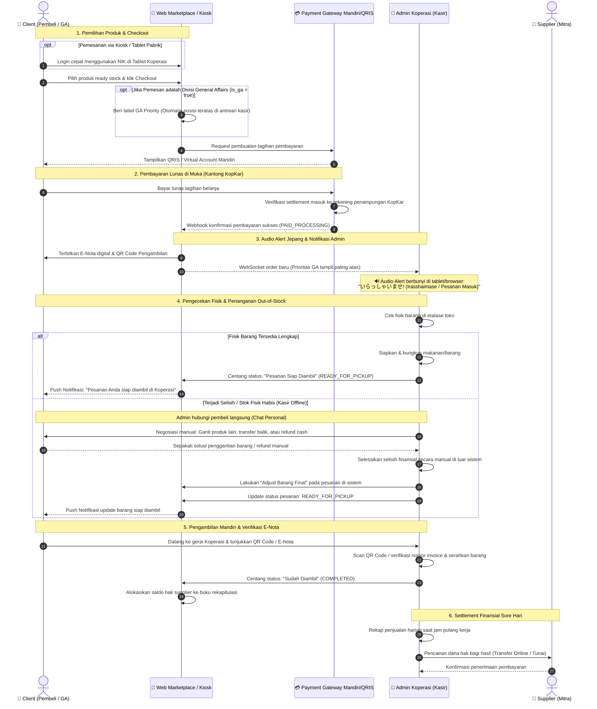
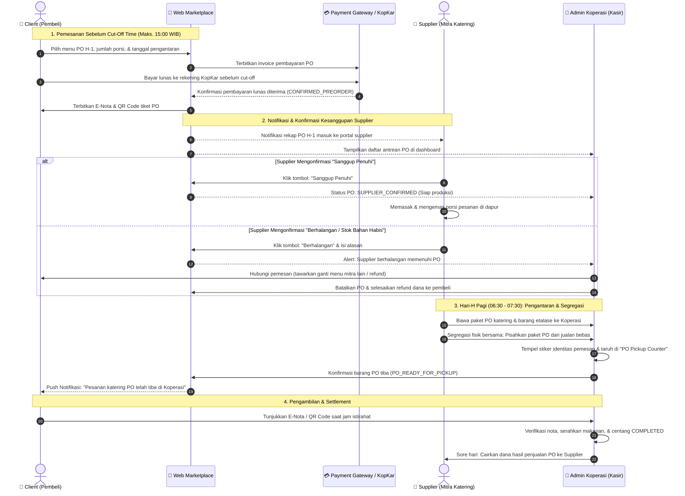
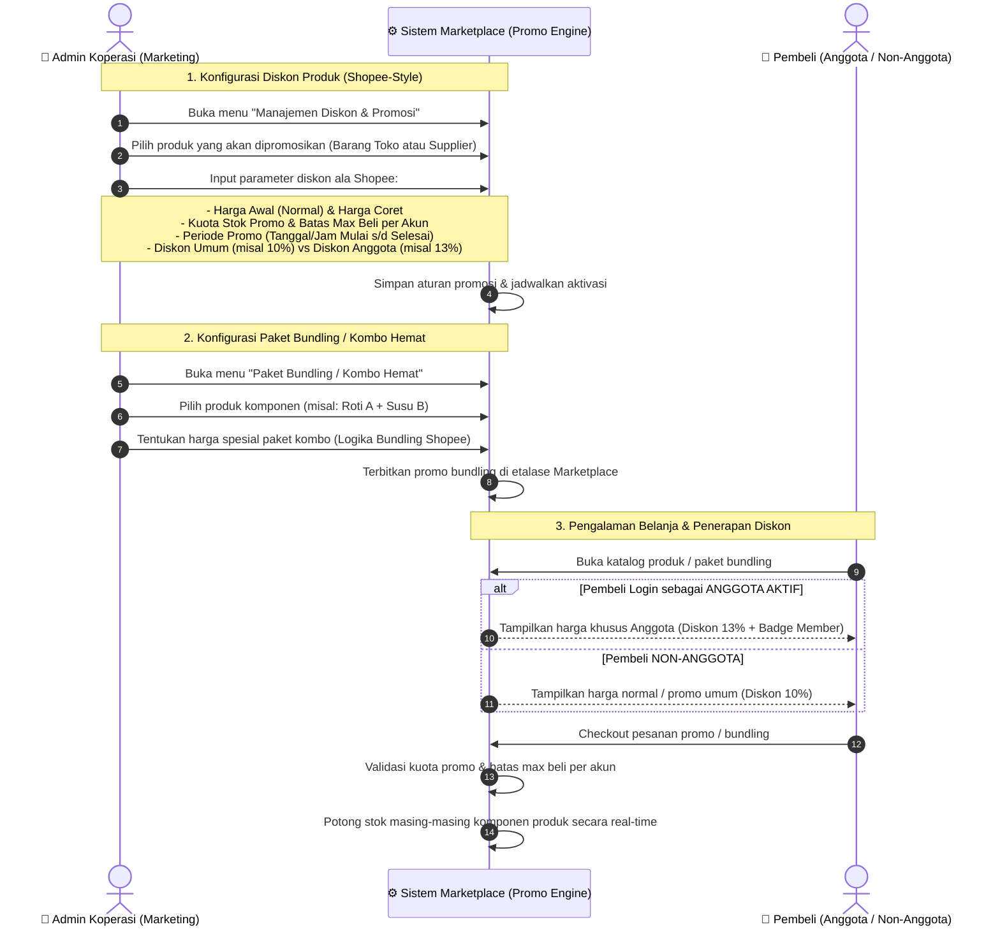
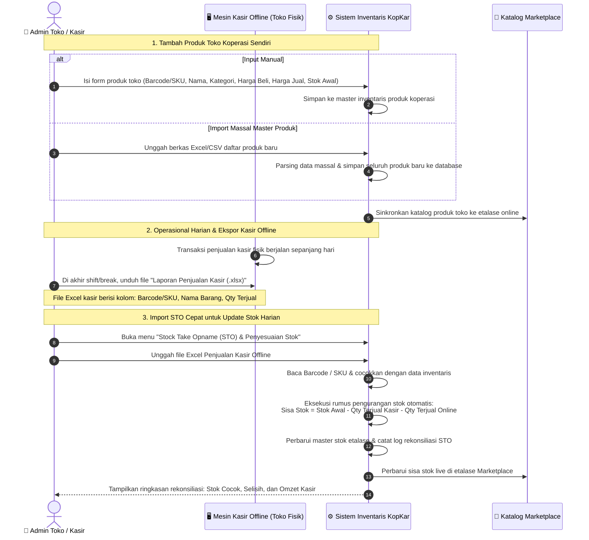

# Modul 1: Pembelian Marketplace, Promosi Shopee-Style & Manajemen Toko
*Dokumen Alur Proses Bisnis & Sequence Diagram Pemesanan, Diskon, Bundling, dan Inventaris Toko*

---

## 1. Deskripsi Modul & Lingkup Bisnis

Modul ini mengatur seluruh siklus perdagangan pada platform Marketplace (`apps/web-marketplace`) dan operasional gerai Koperasi (`apps/web-kopkar`), mencakup:
1. **Pemesanan Hari H (Same-Day Order)** dengan audio alert Jepang (*"いらっしゃいませ! - Irasshaimase"*), antrean prioritas GA, serta alur penyesuaian manual (*order adjustment*) jika stok fisik habis.
2. **Pemesanan Esok Hari (Pre-Order / PO H-1)** dengan cut-off time, konfirmasi kesanggupan supplier, segregasi barang PO, dan pengambilan mandiri.
3. **Akses Kiosk / Tablet Pabrik**: Akses cepat pemesanan di area pabrik bagi karyawan menggunakan NIK.
4. **Manajemen Diskon & Paket Bundling ala Shopee**: Pengaturan harga bertingkat (Diskon Normal vs Diskon Anggota Koperasi), flash sale/periode promo, kuota stok diskon, serta paket kombo hemat (*Bundling Shopee Logic*).
5. **Manajemen Produk Koperasi Sendiri & Import STO Kasir**: Pengelolaan barang milik toko koperasi (manual/import) serta integrasi impor berkas Excel penjualan kasir fisik berbasis Barcode/SKU untuk pemotongan stok otomatis.

---

## 2. Alur 1.1: Pemesanan Hari H (Same-Day Order) & Penyesuaian Stok

> **Kebijakan Stok Habis**: Jika barang yang sudah dibayar ternyata habis akibat selisih kasir fisik offline, hal ini merupakan tanggung jawab admin. Admin akan menghubungi pembeli secara langsung via chat. Penanganan selisih dana (refund tunai, transfer balik, atau ganti produk seharga) diselesaikan secara manual di luar sistem. Admin kemudian melakukan penyesuaian (*adjust*) daftar barang final di sistem.

---

## 3. Alur 1.2: Pre-Order (PO H-1) dengan Konfirmasi Kesanggupan Supplier

> **Kebijakan PO H-1**: Diberlakukan batas waktu pemesanan (*Cut-off Time*, misal pukul 15:00 WIB). Sistem meneruskan rekap PO ke Supplier yang memiliki tombol interaktif untuk mengonfirmasi kesanggupan (*Sanggup Penuhi* vs *Berhalangan*).

---

## 4. Alur 1.3: Manajemen Promosi & Bundling ala Shopee (Admin Toko)

> **Konsep Promosi Shopee-Style**:
> - **Penetapan Harga & Diskon**: Sepenuhnya diatur oleh Koperasi (Supplier hanya menitipkan barang dengan HPP tetap).
> - **Diskon Ganda (Tiering)**: Terdapat diskon khusus **Normal (Non-Anggota, misal 10%)** dan diskon khusus **Anggota Koperasi (misal 13%)**.
> - **Paket Kombo Hemat (Bundling)**: Mengadopsi logika bundling Shopee di mana beberapa produk digabung dengan harga paket hemat. Pengaturan kuota promo, periode waktu (start-end date), dan batas max pembelian per orang dikonfigurasi fleksibel.

---

## 5. Alur 1.4: Manajemen Produk Koperasi & Import STO Kasir via Excel

> **Produk Toko Koperasi**: Barang retail milik Koperasi (bukan titipan UMKM, seperti ATK, minuman kemasan pabrik, snack) dapat ditambahkan manual atau diimpor massal.
> **Import Cepat STO Kasir**: Berdasarkan hasil kesepakatan, sistem menyediakan fitur impor Excel hasil ekspor kasir toko fisik. Sistem mencocokkan data berdasarkan **Barcode / SKU** yang berisi data **"Barang Terjual di Kasir"**, sehingga sistem secara otomatis memotong stok berjalan:
> $$\text{Sisa Stok Sistem} = \text{Stok Awal} - \text{Terjual di Kasir Fisik} - \text{Terjual Online}$$

---

## 6. Referensi Aturan Bisnis Terkait

- `MP-BR-002`: Verifikasi fisik etalase toko dan alur penyesuaian jika stok habis.
- `MP-BR-003`: Aturan Pre-Order H-1 makanan basah dan konfirmasi kesanggupan supplier.
- `MP-BR-004`: Hak antrean prioritas belanja divisi General Affairs (`is_ga = true`).
- `MP-BR-007`: Prosedur rekonsiliasi kasir dan refund manual di luar sistem.
- Promo Shopee-Style: Pengaturan diskon ganda (Anggota vs Non-Anggota) dan paket kombo hemat bundling.
