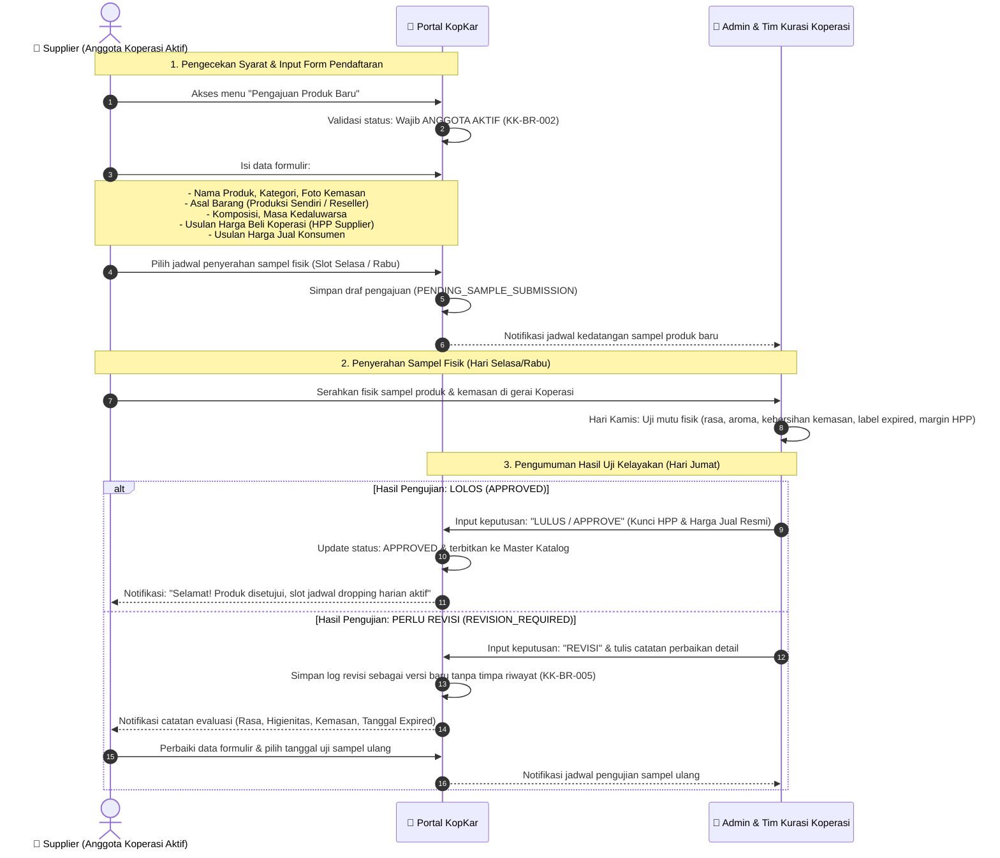
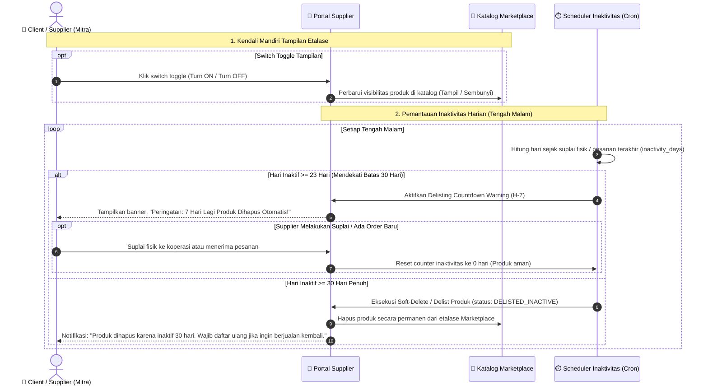
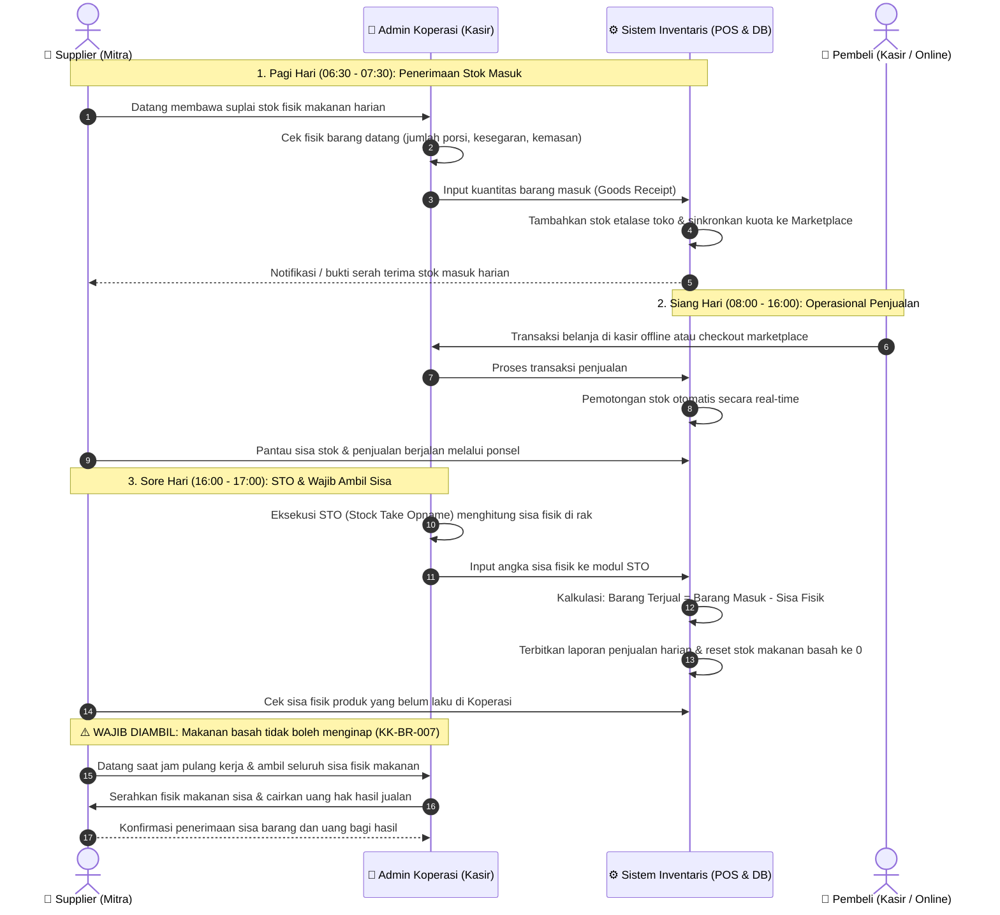
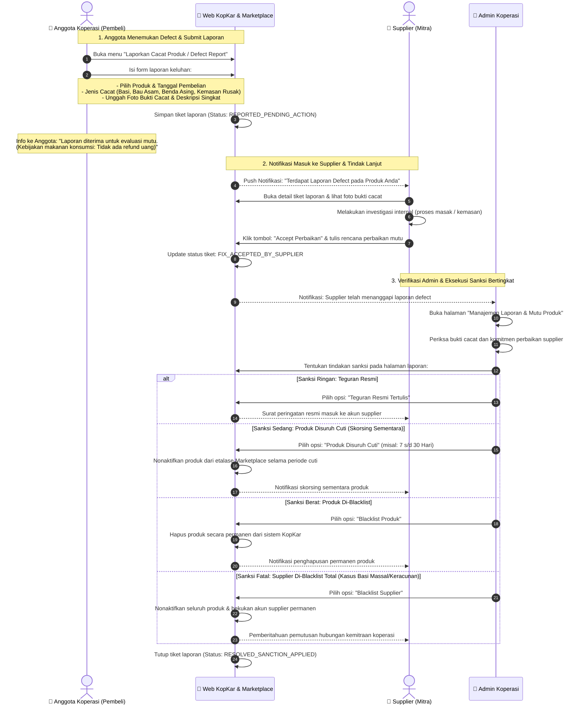

# Modul 2: Manajemen Produk Mitra (Supplier), Uji Sampel, STO & Defect Report
*Dokumen Alur Proses Bisnis & Sequence Diagram Tata Kelola Produk, Sampel, Inventaris, dan Laporan Defect*

---

## 1. Deskripsi Modul & Lingkup Bisnis

Modul Manajemen Produk mengatur siklus hidup produk titipan mitra UMKM/Supplier di ekosistem KopKar dan Marketplace, meliputi:
1. **Pendaftaran Produk Baru & Uji Kelayakan Sampel**: Seleksi mutu makanan basah terikat jadwal baku (Selasa/Rabu penyerahan sampel, Kamis pengujian, Jumat pengumuman kelayakan) dengan syarat mutlak **Supplier wajib Anggota Koperasi Aktif** (`KK-BR-002`).
2. **Kendali Mandiri Supplier & Delisting 30 Hari**: Switch toggle *Turn ON / Turn OFF* etalase serta mekanisme proteksi inaktivitas 30 hari (*countdown warning H-7* sebelum otomatis di-delist).
3. **Operasional Harian & STO Koperasi**: Penerimaan barang pagi, operasional kasir, Stock Take Opname (STO) sore hari, serta **kewajiban supplier mengambil seluruh sisa produk saat jam pulang kerja** (`KK-BR-007`).
4. **Fitur Pelaporan Cacat Produk (Defect Report) & Sanksi Bertingkat**: Pelaporan makanan rusak/basi oleh anggota, *notice & accept* perbaikan oleh supplier, serta penjatuhan sanksi bertingkat oleh Admin (Teguran, Produk Cuti, Produk Blacklist, hingga Supplier Blacklist).

---

## 2. Alur 2.1: Pendaftaran Produk Baru & Uji Sampel Baku

> **Ketentuan Baku Uji Sampel (`KK-BR-004` / `KK-DEC-003`)**:
> - Penyerahan fisik sampel hanya dilayani pada hari **Selasa atau Rabu** (Shift A atau Shift B di lokasi SAI B atau SAI T).
> - Pengujian kelayakan organoleptik dan kemasan dilaksanakan oleh tim Koperasi paling lambat hari **Kamis**.
> - Pengumuman hasil status resmi diterbitkan setiap hari **Jumat**.
> - Pengajuan produk yang berstatus **Revisi** wajib mencatat versi baru tanpa menimpa histori audit (`KK-BR-005`).

---

## 3. Alur 2.2: Kendali Mandiri Supplier & Kebijakan Delisting 30 Hari

---

## 4. Alur 2.3: Operasional Harian Koperasi & Stock Take Opname (STO)

> **Kewajiban Pengambilan Sisa (`KK-BR-007`)**: Produk makanan basah tidak boleh menginap di koperasi karena risiko kedaluwarsa. **Supplier WAJIB mengambil seluruh sisa fisik produk saat jam pulang kerja**. Kerusakan atau barang tidak laku menjadi tanggungan supplier.

---

## 5. Alur 2.4: Fitur Pelaporan Cacat Produk (Defect Report) & Sanksi Bertingkat

> **Kebijakan Defect Makanan**: Karena produk merupakan makanan konsumsi basah (*perishable*), **tidak ada pengembalian uang (no refund)** kepada anggota pembeli. Namun, laporan ini berfungsi sebagai instrumen penjaminan mutu dan dasar penjatuhan sanksi administratif bagi supplier.
> 
> **Pilihan Tingkatan Sanksi oleh Admin**:
> 1. **Teguran Resmi Tertulis** (Catatan evaluasi mutu).
> 2. **Produk Disuruh Cuti** (Skorsing sementara: produk dinonaktifkan dari katalog selama periode evaluasi).
> 3. **Produk Di-Blacklist** (Produk tersebut dihapus permanen dari koperasi).
> 4. **Supplier Di-Blacklist** (Seluruh produk mitra dinonaktifkan dan kemitraan diputus permanen).

---

## 6. Referensi Aturan Bisnis Terkait

- `KK-BR-002`: Syarat wajib supplier adalah anggota koperasi aktif terverifikasi.
- `KK-BR-003`: Format penentuan HPP dan usulan harga jual produk.
- `KK-BR-004` / `KK-DEC-003`: Siklus baku penyerahan sampel (Selasa/Rabu), uji Kamis, dan pengumuman Jumat.
- `KK-BR-005`: Riwayat versi perbaikan form tanpa menghapus audit trail.
- `KK-BR-006`: Delisting otomatis setelah 30 hari tanpa suplai dan tanpa transaksi.
- `KK-BR-007`: Tanggung jawab finansial dan kewajiban retur sisa barang harian oleh supplier.
- `KK-BR-008`: Manajemen keluhan mutu produk dan sanksi bertingkat (Teguran, Cuti Produk, Blacklist Produk, Blacklist Supplier).
