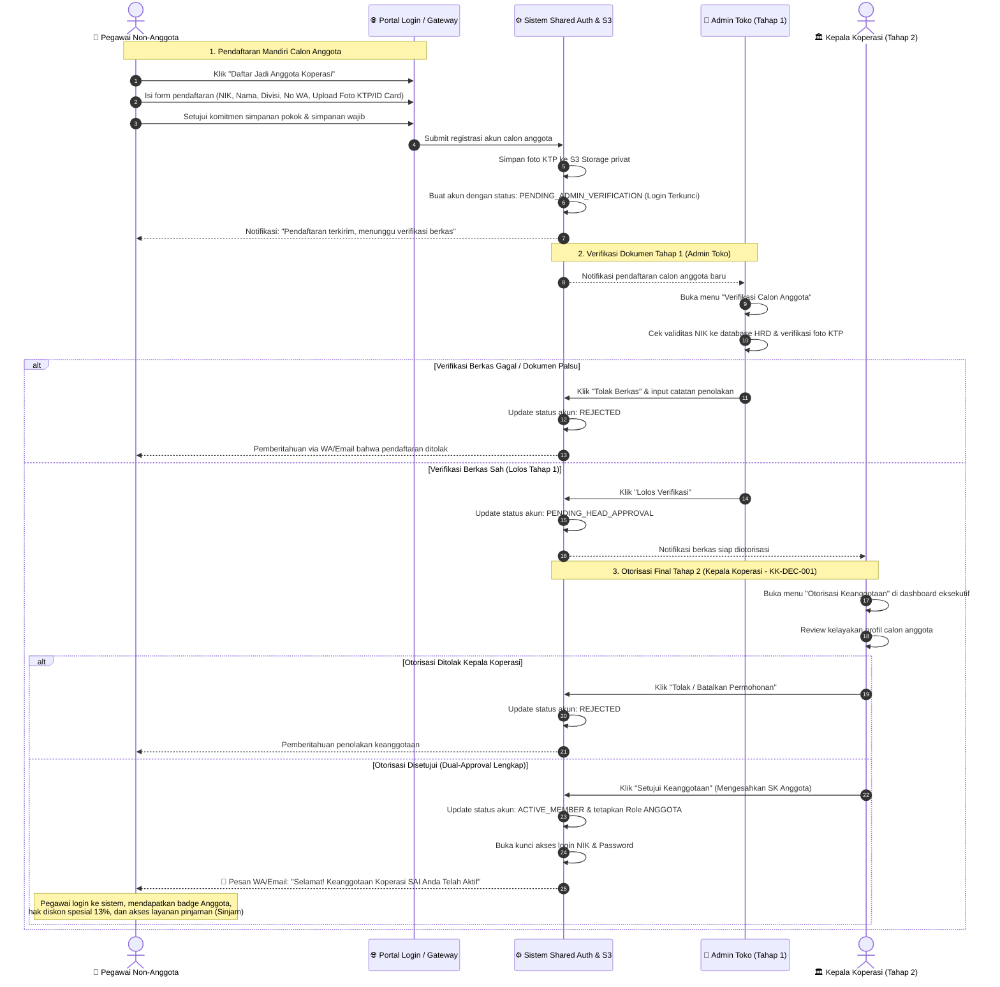

# Modul 3: Manajemen User & Keanggotaan (Dual-Approval)
*Dokumen Alur Proses Bisnis & Sequence Diagram Onboarding & Verifikasi Berjenjang*

---

## 1. Deskripsi Modul & Lingkup Bisnis

Modul Manajemen User & Keanggotaan mengatur tata kelola identitas akun karyawan dalam ekosistem KopKar SAI. Sesuai prinsip governance **Dual-Approval** (`KK-DEC-001` / `KK-BR-001`), calon anggota tidak dapat diaktifkan secara instan atau sepihak, melainkan wajib melalui dua lapis verifikasi:
1. **Verifikasi Tahap 1 (Admin Toko)**: Memeriksa validitas data karyawan (NIK internal PT SAI), kejelasan foto KTP, dan kelengkapan departemen/divisi.
2. **Otorisasi Tahap 2 (Kepala Koperasi)**: Otorisasi final persetujuan resmi keanggotaan dan komitmen simpanan pokok/wajib.

> [!CAUTION]
> **Larangan Akses Login Sebelum Approval Sah**: Akun yang masih berstatus `PENDING_ADMIN_VERIFICATION`, `PENDING_HEAD_APPROVAL`, atau `REJECTED` **dilarang keras** diberikan akses login ke Koperasi maupun Marketplace.

---

## 2. Alur 3.1: Registrasi Pegawai Non-Anggota Menjadi Anggota Koperasi

### Sequence Diagram: Dual-Approval Onboarding

---

## 3. Rincian Tahapan & Hak Istimewa Anggota

| Tahapan Status | Aktor Penanggung Jawab | Aksi & Validasi |
| :--- | :--- | :--- |
| `DRAFT / INPUT` | Pegawai Non-Anggota | Mengisi NIK, identitas diri, mengunggah foto KTP / ID Card ke S3 storage terenkripsi, menyetujui pemotongan simpanan. |
| `PENDING_ADMIN_VERIFICATION` | Admin Toko | Memeriksa validitas NIK terhadap data induk karyawan PT SAI. Memeriksa keabsahan foto identitas. |
| `PENDING_HEAD_APPROVAL` | Kepala Koperasi | Meninjau berkas yang lolos seleksi administratif dan menandatangani persetujuan keanggotaan resmi secara digital. |
| `ACTIVE_MEMBER` | Sistem KopKar | Akun aktif. Karyawan menerima pesan konfirmasi WhatsApp dan dapat login secara mandiri. |

### Keuntungan Menjadi Anggota Aktif:
1. **Hak Diskon Khusus**: Anggota aktif mendapatkan potongan belanja lebih besar di Marketplace (contoh: 13% untuk anggota vs 10% untuk non-anggota).
2. **Akses Fasilitas Finansial**: Hak menggunakan kalkulator simulasi dan mengajukan fasilitas pinjaman koperasi.
3. **Peluang Menjadi Supplier**: Hak mengajukan produk jualan mandiri untuk dititipkan di gerai KopKar (`KK-BR-002`).

---

## 4. Referensi Aturan Bisnis Terkait

- `SH-BR-001`: Single account berbasis NIK karyawan untuk seluruh ekosistem Koperasi & Marketplace.
- `KK-BR-001` / `KK-DEC-001`: Invarian Dual-Approval pendaftaran anggota (Admin Toko $\rightarrow$ Kepala Koperasi).
- `SH-DEC-003`: Penyimpanan foto KTP & dokumen sensitif wajib ke S3-compatible Object Storage dengan presigned URL privat.
