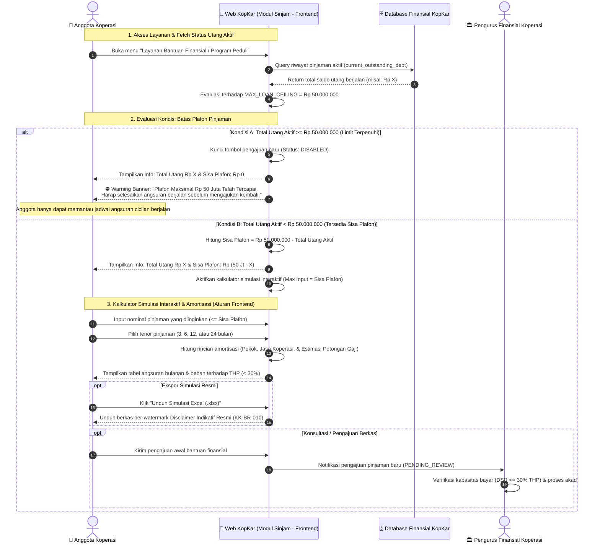

# Modul 4: Layanan Finansial & Simulasi Simpan Pinjam
*Dokumen Alur Proses Bisnis & Sequence Diagram Evaluasi Plafon Maksimal Rp 50 Juta & Kalkulator Simulasi*

---

## 1. Deskripsi Modul & Lingkup Bisnis

Modul Simpan Pinjam dirancang dengan filosofi mengayomi dan membantu karyawan PT SAI dalam kebutuhan finansial, tanpa mencoreng citra atau memberikan kesan membebani utang (*"Ndelepno Jeneng Sinjam"* — fokus sebagai fasilitas program bantuan kesejahteraan anggota).

> [!NOTE]
> **Catatan Pengaturan Frontend**:
> Sesuai kesepakatan pengembang, penataan antarmuka kalkulator interaktif, slider nominal, pilihan tenor, dan komponen visualisasi amortisasi diserahkan sepenuhnya kepada **Frontend Developer** untuk diatur secara fleksibel. Namun, logika validasi batas kredit di sisi backend tetap mengikat secara ketat:
> 1. **Batas Plafon Maksimal Rp 50.000.000**: Total akumulasi seluruh pinjaman aktif seorang anggota tidak boleh melebihi Rp 50 Juta.
> 2. **Transparansi Riwayat Utang**: Anggota dapat melihat riwayat utang berjalan secara transparan.

---

## 2. Invarian Finansial Pokok

1. **Transparansi Riwayat Utang**: Anggota dapat melihat secara transparan rekapitulasi total utang aktif yang sedang dimilikinya.
2. **Plafon Akumulasi Maksimal Rp 50.000.000**:
   - Total keseluruhan eksposur pinjaman aktif seorang anggota **tidak boleh melebihi Rp 50.000.000**.
   - **Kondisi Utang $\ge$ Rp 50 Juta**: Sistem secara otomatis **MEMBLOKIR** pengajuan baru dan menonaktifkan tombol pengajuan (*Disabled*).
   - **Kondisi Utang $<$ Rp 50 Juta**: Anggota diizinkan melakukan simulasi pinjaman baru dengan batas maksimal plafon sebesar:
     $$\text{Sisa Plafon Pinjaman} = \text{Rp } 50.000.000 - \text{Total Utang Aktif Saat Ini}$$
3. **Simulasi Interaktif & Disclaimer Resmi**:
   - Anggota dapat menguji skenario tenor (3, 6, 12, 24 bulan) dan melihat estimasi angsuran pokok, jasa koperasi flat/menurun, serta proyeksi potongan gaji bulanan (payroll deduction).
   - Seluruh hasil perhitungan simulasi yang diekspor menyertakan watermark / footnote disclaimer indikatif (`KK-BR-010`).

---

## 3. Alur 4.1: Evaluasi Limit Plafon Akumulasi Rp 50 Juta & Simulasi

### Sequence Diagram: Simulasi Pinjaman & Validasi Limit Plafon

---

## 4. Matriks Logika Validasi Plafon Pinjaman

| Kondisi Utang Berjalan | Status Tombol | Kapasitas Pinjaman Baru | Tampilan Antarmuka Sistem |
| :--- | :---: | :---: | :--- |
| **Rp 0 (Nol)** | Aktif | Rp 50.000.000 | Akses penuh kalkulator simulasi hingga batas maksimal Rp 50.000.000. |
| **Rp 15.000.000** | Aktif | Rp 35.000.000 | Input kalkulator dibatasi maksimal Rp 35.000.000. |
| **Rp 45.000.000** | Aktif | Rp 5.000.000 | Input kalkulator dibatasi maksimal Rp 5.000.000. |
| **Rp 50.000.000** | **Disabled (Kunci)** | **Rp 0** | Alert: *Plafon pinjaman maksimal telah tercapai. Harap lakukan pembayaran cicilan.* |
| **> Rp 50.000.000** *(jika ada tunggakan/denda)* | **Disabled (Kunci)** | **Rp 0** | Alert: *Batas eksposur kredit terlampaui. Harap berkonsultasi dengan pengurus.* |

---

## 5. Referensi Aturan Bisnis Terkait

- `KK-BR-009`: Ruang lingkup modul simpan pinjam fase ini berfokus pada kalkulator interaktif simulasi angsuran dan mitigasi risiko kredit.
- `KK-BR-010`: Kewajiban watermark/footnote disclaimer pada berkas ekspor hasil perhitungan amortisasi.
- Invarian Batas Kredit: Limit eksposur pinjaman agregat per anggota dibatasi pada angka maksimal **Rp 50.000.000**.
